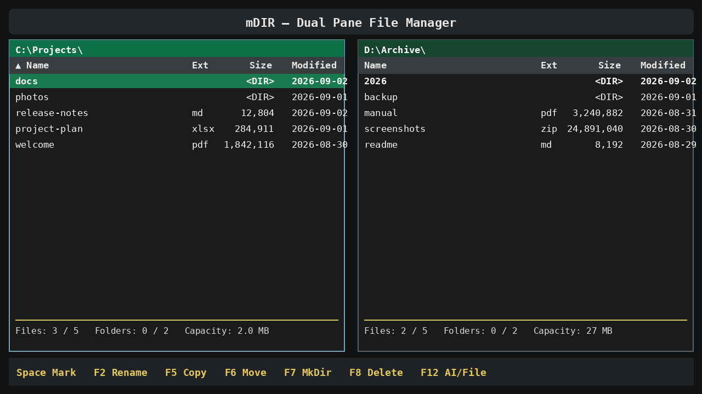

## Duplicate Quarantine (proposed next release)

In **Ctrl+Shift+D → Duplicate Review**, click **Smart Select** to mark the
extra copies in each **Exact (SHA-256)** duplicate group. One available copy
per group stays in its original directory; explicitly **KEEP**-marked files
are never selected. Review or change marks before proceeding.

Click **Move to Folder**, enter an absolute destination path (such as
`G:\\mDir_Quarantine`), then confirm once. Files are moved **without
overwriting** existing destination files. Naming collisions receive
`name-(01).ext`, `name-(02).ext`, etc. The destination contains an
`mdir-quarantine-YYYYMMDD-*.csv` journal with each moved file's original
absolute path, destination, group, size, SHA-256 and timestamp for later
manual review and restoration. The Duplicate Review results refresh when
moving is complete.

**Safety / current limits:** Same-filesystem moves only, including a selected
destination on the same drive. Cross-volume moves are blocked rather than
copy/delete behind your back. The program verifies each file against a
remaining original copy before moving. Similar-looking images are not eligible
for automated moving. Files are **not deleted** by Quarantine. The quarantine folder receives a `.mdir-quarantine-folder` marker and is
excluded from subsequent exact/similar duplicate scans, even when it resides
inside the scanned root. Do not delete that marker while keeping quarantined
files there.
The CSV supports manual restore; a dedicated restore UI is not yet provided.

## 2.26.58 - Automatic refresh after confirmed duplicate recycling

When files have been moved to the Windows Recycle Bin, the **Duplicate Review** result list refreshes automatically. It removes successfully recycled entries and also hides the sole surviving file of a now-resolved duplicate group. **The survivor remains in its original folder** and is not removed. Current duplicate group count, remaining rows, marked selections, and page counters are recalculated; the top banner reports **RECYCLED N / RESULTS REFRESHED**, so you can distinguish successful deletion from merely marking candidates.

This is a fast update against the original scan snapshot: the app checks availability of already listed paths rather than running the entire SHA-256 search again. To discover newly added duplicates on the drive, start a new scan with Ctrl+Shift+D after closing the review. Failed recycle operations preserve files and display errors, and the full pre-cleanup CSV remains available in `%LOCALAPPDATA%\\mDIR-P\\reports`.

## 2.26.57 - Display artifacts after popup and auto-refresh

If lines or old cells remain after a popup or a large directory automatic refresh, press **Ctrl+Alt+R** on the main file manager to repaint both cached panes (no files are rescanned, moved, or deleted). This version holds automatic directory list rebuilds while a translucent modal covers the panes, then resumes polling and performs layout-aware repaints on modal return.

Windows Terminal or graphics drivers may still exhibit rendering artifacts independently of mDIR. As a separate reversible Windows Terminal diagnostic, enabling the documented root-level `experimental.rendering.forceFullRepaint` setting can distinguish dirty-region rendering issues from application layout bugs; use only if needed, and revert if it has no effect.

## 2.26.57 - Recycle all marked duplicates with one confirmation

To remove several copies directly in Duplicate Review, mark the copies with **click / Space / Mark Row**. The action **Recycle All Marked (N)** uses the checked files, **not** the row under the cursor. Click it, review the total and the first path, and confirm **Recycle All N** once. Every marked file is processed in sequence after its content and remaining survivor are verified with SHA-256. A full-path pre-cleanup CSV is saved automatically.

The previous arbitrary 100-files-per-batch limit is removed. Processing is cancellable between files through **Stop Cleanup**. If any selected file is **Keep**, changed/unavailable, or all copies within a group are selected, the entire batch is blocked **before** starting; unmark ineligible rows and retry. The completion message shows the number successfully moved to Windows Recycle Bin and the number not recycled, and the results stay open for further review. Windows may not offer Recycle Bin support on some drives; there is no permanent deletion fallback.

## 2.26.56 - Duplicate multi-select visibility and safe deletion diagnostics

The **Mark** column in Duplicate Review now displays **✓ MARK** in green for selected files and a muted dash for unselected files. **Click a row / Mark Row / Space** marks the row; **Shift+Up/Down** extends marks. The review footer indicates **Marked**, **Eligible to recycle**, and **Protected/unavailable**. Marking every copy in one group makes that group **ineligible** until at least one copy is unmarked. If a duplicate file has been moved, deleted, or become inaccessible since scanning, re-scan the folder.

**Delete Marked (N)** operates only on eligible **Exact** SHA-256 matches, with a separate confirmation, a pre-cleanup CSV, and one-file-at-a-time Windows Recycle Bin operations. Blocking conditions and Recycle Bin errors are shown persistently rather than silently discarded by cursor movements. If Windows refuses to recycle from a drive, the error is shown and mDIR does **not** permanently delete the file. Keep records and original paths are preserved.

## 2.26.55 - Mark multiple duplicates and recycle safely

In **Duplicate Review**, click a file row or press **Space** to mark/unmark it; **Shift+Up/Down** extends marks. The **Mark** column shows `[x]` for marked files and marks are retained across pages. Select **Delete Marked (N)** to review the batch before confirmation. Up to **100** marked exact duplicates can be recycled per confirmation, with SHA-256 re-verification, an audit CSV created before deletion, per-file status and **Stop Cleanup**.

mDIR will not choose which original to keep: if you mark *all* copies in any duplicate group, that group is excluded until at least one copy is unmarked. `Keep` files, changed files, and visually similar images are never batch-recycled. The Windows Recycle Bin is the only destination; there is no automatic or permanent deletion. The existing **Delete Selected** button is still available for single-file operations.


After **Ctrl+Shift+D**, press **Background** in the duplicate scan dialog to continue managing your files in both panes. A short **DUP SCAN** message stays at the beginning of the main bottom status line; when another action updates status, duplicate progress remains visible as its prefix. The indicator updates periodically while scanning is in background.

SHA-256 percent is **verified candidate files / total same-size candidates**; it is phase-specific rather than a made-up overall percent. The initial recursive folder scan and optional similar-image scan cannot display a reliable percentage until their totals are known, so they show their phase and discovered count instead. Progress may take longer on very large individual files even if the verified-file count has not changed.

**Ctrl+Alt+D** reopens an active duplicate scan, including **Cancel Scan**. If background scanning has finished, Ctrl+Alt+D opens the complete **Duplicate Review** results without automatically interrupting your current task. A scan kept in foreground opens results automatically as before. Existing Keep/Review/Candidate labels, pre-cleanup reports, and single-file Recycle Bin protections are preserved.

## 2.26.54 - Delete an individually selected exact duplicate in Duplicate Review

In the Ctrl+Shift+D **Duplicate Review** list, highlight a row. Its complete original path and the number of remaining listed copies are shown below the table. **Delete Selected** is available only for an **Exact** SHA-256 group with another existing listed copy, excluding **Keep** files and files changed since review. Clicking the button opens a **second confirmation** identifying the full selected path and a copy that will remain.

On confirmation, mDIR saves a timestamped **pre-cleanup CSV** of the full result list to `%LOCALAPPDATA%\\mDIR-P\\reports` (first deletion in the current session). The selected file and another remaining duplicate are freshly SHA-256 hashed; only after they still match is that one selected file sent to the **Windows Recycle Bin**. The app does not permanently delete anything in this workflow, including large files; failed recycle operations stop safely. The result window stays open and the row disappears if recycling succeeds.

**Caution:** Byte-identical files can still serve different roles, and other documents may refer to a particular location. Check paths before recycling. **Keep** continues to protect intentional copies, **Candidate** remains a label, and **Similar** image matches cannot be recycled here. No batch or automatic deletion is performed.

## 2.26.53 - Where duplicate scan results appear

Press **Ctrl+Shift+D** from the currently open folder (e.g. `G:\\`); after confirming, an in-app **Duplicate Search — IN PROGRESS** window explicitly shows what is happening. SHA-256 scanning of a large music library can take some time; the counter reports verified files and the number of matching-size candidates to be checked. The program then checks visually similar images (if Pillow is installed, up to 5,000 images).

**The result list is NOT the footer status message.** On successful completion, the progress window closes and the separate **Duplicate Review** result window opens automatically with exact duplicate groups, filenames, original folder locations, review labels, notes, and CSV export. This happens even when there are no duplicates. The current search results are not automatically saved; use **Export CSV** to keep an independent report in the user's `%LOCALAPPDATA%\\mDIR-P\\reports` folder. Manually saved Keep/Review/Candidate labels and notes remain in `duplicate_reviews.json`.

**Cancel Scan** (or Escape) safely interrupts the search without deleting files. A cancelled search will not open partial results, and no automatic deletion occurs at any point.

## 2.26.52 - Recursive Duplicate Review searches the current folder

**Ctrl+Shift+D** always searches the **current open directory** plus all accessible subfolders, regardless of the selected row. For example, at `G:\\`, a highlighted `G:\\Audiobooks` folder no longer restricts the scan: all of `G:\\` is examined. To search only Audiobooks, enter `G:\\Audiobooks` first and then start Duplicate Review.

The confirmation and results indicate the chosen search root. Exact duplicates are found by matching content (SHA-256), not filename; files directly in the root and inside nested folders are compared together. Large drives may take a long time to hash; status messages distinguish scanning from hashing. Inaccessible directories and unreadable files produce visible **INCOMPLETE** warnings, rather than silently claiming the drive was fully checked. Symlink/reparse directory traversal is not followed to avoid loops; visually similar image detection separately examines up to 5,000 images. No file is deleted or moved by this feature.

## 2.26.51 - Safe duplicate review

Open **Ctrl+Shift+D** on a selected folder (or the current pane's folder) to review duplicates recursively. The exact duplicate finder hashes equal-sized files with SHA-256; any **Similar** image group is a perceptual resemblance, **not** verified identical content. Files with different names can be exact duplicates, and two files with the same name can have different content.

The review screen shows **150 entries per page**. Select each copy and choose **Keep** for intentional backups/linked project references, **Review** if uncertain, or **Candidate** for possible removal after manual inspection. **None of these buttons delete or move files.** Add a **Note** explaining why the file was retained. **Location** jumps to the original file in mDIR, while **Export CSV** saves a full list of groups, full paths, decisions and notes (including Keep copies) under the per-user `reports` directory. On Windows, the manifest is stored at `%LOCALAPPDATA%\\mDIR-P\\duplicate_reviews.json`.

Keep notes are attached to full file paths and file size/modified-time fingerprints. A changed file is flagged for Review while the old note stays visible. Renamed/moved files appear as new paths; the exported CSV preserves the previous record for audit. Files aren't automatically deleted, replaced with shortcuts, or changed to hard links; those operations could break dependent documents and are deliberately excluded.

Scanning 100,000+ large files may require significant disk reads, especially if many files share the same size. Use a selected subfolder for more targeted runs, and keep a full backup before any unrelated manual cleanup.

## 2.26.50 - Background transfer display stability

- Keep terminal panes clean after switching between the fullscreen progress modal and the independent Windows background progress window. Repaint visible cells on return without rescanning a directory.
- Suppress duplicate live status redraws under the native progress window and prevent stale automatic folder refreshes from overwriting newer rows.
- Large directory handling is optimized from **20,000 entries**; this is a threshold, **not a maximum file count**. For music libraries containing 100,000–330,000 files (roughly 500 GB–1 TB at 3–10 MB/file), the filesystem may accommodate them, but memory use and sorting/render speed vary considerably. No 100,000+ file guarantee is made without a benchmark on the target PC. For smoother routine use, consider folders of roughly 5,000–20,000 files each.

## 2.26.49 - Stable theme switching and Norton focus

**Norton Commander** now follows the same active-panel direction as Basic and
Old-MDIR: the active pane is darker navy, the inactive pane classic royal blue,
and the active selection remains bright cyan. Switching between custom and
built-in themes rapidly now reapplies the last selected skin and filename colors
after the Theme picker redraws. The exact 24-theme order and Basic default from
2.26.48 remain unchanged.

## 2.26.48 - Theme ordering and the new Basic default

The first option and new-installation default is **mDir theme (basic)**, followed by **Old-MDIR**, **Norton Commander**, and then the 21 built-in themes in the requested order (ansi-dark through tokyo-night). The standard **F10 > Theme** search palette retains fuzzy filtering while displaying themes in that exact order when opened.

Existing saved theme choices remain in effect. Older saved names `mDir theme` and `old_M_tema` automatically map to `mDir theme (basic)` and `Old-MDIR`, without deleting your settings.

## 2.26.47 - Old-MDIR theme name and clearer active panes

The DOS mDir theme formerly shown as `old_M_tema` is now **Old-MDIR**. Existing saved theme choices automatically migrate on the next launch, so your theme preference is preserved.

Across the standard mDir, **Old-MDIR**, Norton Commander, and Textual Light skins, the active pane retains its vivid native colors, clear selected row and strong border, while the passive pane has softer text, a more muted border, and a distinguishable list background. Switching with Tab or mouse changes the visual emphasis immediately. The classic themes retain their signature coral/teal and blue/cyan palettes.

## 2.26.46 - Darker active pane and Ctrl+T Thumbnail/List

The default **mDir theme** now renders the **active file pane in deep black (#191919)** and the **inactive pane in softer charcoal (#292929)**. Both file lists, row backgrounds, and pane information areas follow focus on Tab/mouse click. Active border and highlighted selection remain high-contrast. Retro Original, Norton Commander, and alternate light skins retain their colors.

**Ctrl+T** now toggles **Thumbnail / List** in the active pane on Windows; the Th button still works. **Alt+T** continues to select the T: drive. This replaces the cumbersome Ctrl+Alt+T thumbnail combination.

## 2.26.45: Every Alt+letter switches that Windows drive

All **26** shortcuts **Alt+A ... Alt+Z** now switch the ACTIVE Windows pane directly to the matching drive, provided that drive exists. This also registers the shortcuts with the native Windows keyboard dispatcher rather than only the terminal UI, so Windows Terminal cannot swallow some letters. **Alt+T** is now T: drive; the Thumbnail/List toggle moves to **Ctrl+Alt+T** (or the unchanged **Th** button). Existing settings, F9 Zip/Unzip, and Alt+F9 Drive menu are preserved. Ubuntu remains path/mount-based instead of drive-letter-based.

## 2.26.44: direct drive keys and smart F9 ZIP

On Windows, **Alt+C**, **Alt+D**, **Alt+S** (and most other Alt+drive letters) open that drive's root directly in the **active** pane without changing the opposite pane. A missing drive reports an error without navigating. **Alt+T** changes to T: starting with v2.26.45; thumbnail switching uses **Ctrl+Alt+T**. The drive selection dialog is still available on **Alt+F9** (or Alt+F1/Alt+F2 for the left/right pane).

**F9 Zip/Unzip** uses the built-in archive dialogs: selecting files or folders makes a ZIP in the opposite pane; selecting exactly one `.zip` extracts it into the opposite pane. Archive creation and extraction remain cancellable with progress and overwrite protection. `Alt+F5` and `Alt+F6` remain direct ZIP creation/extraction shortcuts. **RAR/7z/TAR extraction is not yet implemented**; F9 shows an explicit message instead of treating those archives as regular files. Your saved keymap is preserved and a previous Drive=F9 entry migrates automatically.

## 2.26.43 - F6 filename prefill

For a single selected file or directory, F6 RenMov now displays the destination folder **and its original name**. Edit the name to move and rename at the same time, or leave it unchanged to move with the original name. For multiple selections only the destination directory is shown; each selected item retains its name. The destination still defaults to the opposite pane. Existing overwrite confirmations are preserved.

## 2.26.42 - F6 Rename/Move

The full-width footer now starts at F3: Parent (Backspace), Mark (Space), and F2 Rename remain functional but are hidden from the footer. F6 **RenMov** opens one destination field. Type a bare new name to rename a single item in place, an existing directory to move selected items, or a full target filename to move and rename a single item. The default target is the opposite pane. An overwrite always requires explicit confirmation; directory self-moves are rejected.

## Version 2.26.41: active pane and full-width footer

- Brighter selected-row highlight and cyan border identify the active working pane; inactive selection stays quieter but readable.
- Evenly distribute and center footer function keys across the whole window; preserve 3-row click targets and bottom safety row.
- Narrow terminals retain horizontal scrolling for long command bars.
- Original mDir and Norton Commander skins remain available.

# mDIR-P

**A fast, free dual-pane file manager for Windows.** Classic MDIR speed,
modern previews, safe file operations, and integrated AI —
inside PowerShell and Windows Terminal.

[](https://github.com/jtl-sun/mdir-p/releases/latest)
[](LICENSE)
[](https://github.com/jtl-sun/mdir-p/actions)

> **Free and open source.** Built so Windows users can manage files quickly
> without subscriptions, ads, or account registration.

### Download for Windows

[**Download the latest stable mDIR-P**](https://github.com/jtl-sun/mdir-p/releases/latest)
· [Release notes](https://github.com/jtl-sun/mdir-p/releases)
· [Ubuntu version](https://github.com/jtl-sun/mdir-u)

Extract the ZIP, close any running mDIR window, and double-click
**`INSTALL_MDIR.bat`**. Then start mDIR from the desktop shortcut or type
`m` in a terminal.



## Dedication

MDIR-P is a tribute to **Choi Jung Han**, the developer of the legendary
DOS-era file manager **MDIR**. His work inspired generations of users to
manage files quickly and efficiently from the keyboard.

## Project direction

mDIR-P is a modern dual-pane file manager built around the speed and directness many users remember from DOS-era file managers. The project aims to make file work comfortable for Linux users while also remaining natural in Windows and PowerShell environments. Its modern pillars are **AI/File**, **File View / Preview**, and **File Search**.

As a matter of project identity and respect for the classic Mdir lineage, mDIR-P stays on the **V2.xx.xx** version series and does not adopt a V3.x version number.

### Themes

- **mDir theme (basic)** - default modern dark skin with a darker active file pane.
- **Old-MDIR** - original DOS-inspired mDir styling: dark working pane, coral directories and cursor, and distinctive extension colors.
- **Norton Commander** - classic blue/cyan/yellow palette with a darker active pane and a bright cyan cursor.
- **21 built-in themes** - ordered from ansi-dark through tokyo-night.

Select a theme with **F10 > Theme**. The exact 24-theme list is ordered as above, and your chosen theme is saved across launches; existing user settings are preserved.

## Highlights

- Fast dual-pane file management inspired by MDIR and Total Commander
- Recent Folders (`▼`) drop-down at the far right of both directory path bars with a shared persistent MRU history; one click opens the list, clicking anywhere else closes it and immediately activates the clicked control, and `Alt+Down` opens it for the active pane
- Responsive handling of folders containing 20,000 or more image files
- Preview for images, PDF, Excel, Word, PowerPoint, CSV, text, and Markdown
- Excel, Word, and PowerPoint Preview use a fast cached PDF pipeline for faithful Office layout
- Mouse-wheel zoom and drag-to-pan in Preview
- Integrated AI terminal with Codex, PowerShell, and Ollama providers
- Copy, move, rename, delete, search, drive selection, and editable paths
- Responsive background Copy, Move, and Delete for batches exceeding 1,000
- Windows long-path-aware Copy/Move with compact transactional staging for deep project trees such as Unity caches
  items, with live progress and cancellation
- Compact overwrite warning before Copy or Move replaces a same-name item
- Advanced file search with filename patterns, content search, depth and
  hidden/system controls, live progress, cancellation, and clickable results
- Safe batch rename with live preview, tokens, counters, and find/replace
- Built-in ZIP compression and secure ZIP extraction without extra software
- Safe, size-limited text viewing and editing with `F3` and `F4`
- Total Commander-inspired default theme
- Configurable top shortcut bar for files, folders, programs, websites,
  PowerShell commands, and MDIR-P actions
- Windows Terminal and Korean IME support

## Requirements

- Windows 10 or Windows 11
- Python 3.11 or newer
- PowerShell or Windows Terminal

## Installation on Windows

### Easy installation or update (recommended)

1. Open the **latest Release** from the Download section above.
2. Download the current stable `mDIR-P-<version>.zip` release asset.
3. Extract the ZIP and open the extracted mDIR-P folder.
4. Double-click **`INSTALL_MDIR.bat`**. The installer also creates an isolated Windows Terminal profile named **mDIR** for the desktop shortcut. That profile hides the Terminal host scrollbar and uses zero terminal padding so the dual panes can occupy the complete terminal viewport; no other Terminal profile is changed.

Use **Code > Download ZIP** only when you intentionally want the current
`main` development source rather than the latest published stable release.

The installer creates a private environment under `%LOCALAPPDATA%\mDIR`,
installs Preview support, creates permanent `m` and `mdir` commands, adds the
command folder to the user PATH, and places an **mDIR** shortcut on the
desktop. To update later, download the newest ZIP and double-click the same
file again. The installer verifies that the installed version exactly matches
the downloaded source. Personal settings are preserved.

If Windows SmartScreen appears, choose **More info > Run anyway** only after
confirming that the ZIP came from this repository.

### Manual installation from the ZIP

1. Download the repository as a ZIP file and extract it.
2. Open the extracted folder. Confirm that `pyproject.toml` is visible there.
3. Right-click an empty area in the folder and select **Open in Terminal**.
4. Run the following commands in PowerShell:

```powershell
python -m pip install --upgrade pip
python -m pip install --upgrade ".[preview]"
python -m mdir
```

Do not enter an old Wheel filename such as
`mdir_p-2.17.0-py3-none-any.whl`. GitHub source ZIP files normally do not
include a Wheel. Installing `.[preview]` uses the current source version in
the folder.

If `pyproject.toml` is not shown, the terminal is in the wrong folder. Move
into the inner extracted folder first. For example:

```powershell
cd .\mdir-p-main
python -m pip install --upgrade ".[preview]"
```

### Install with Git

```powershell
git clone https://github.com/jtl-sun/mdir-p.git
cd mdir-p
.\INSTALL_MDIR.bat
```

### Optional: Use a virtual environment

```powershell
python -m venv .venv
Set-ExecutionPolicy -Scope Process -ExecutionPolicy Bypass
.\.venv\Scripts\Activate.ps1
python -m pip install --upgrade ".[preview]"
```

The tested Textual version is pinned by `pyproject.toml`, so a fresh install
uses the same UI framework version as the automated tests.

## Upgrade

Download the newest ZIP and double-click `INSTALL_MDIR.bat` again. For a Git
checkout, run:

```powershell
git pull
.\INSTALL_MDIR.bat
```

Personal settings such as shortcuts are stored separately and are not removed.

## Run

After installation, any of these commands starts MDIR-P:

```powershell
m
M
mdir
```

PowerShell command names are case-insensitive, so `m` and `M` run the same
launcher. The longer `mdir` command is provided as an alternative.

Without installation, run:

```powershell
python -m mdir
# or
.\start_mdir_p.ps1
```

## PowerShell Script Policy Error

If PowerShell reports that `start_mdir_p.ps1` or `Activate.ps1` cannot be
loaded because script execution is disabled, the application itself is not
damaged. You can always start it without a PowerShell script:

```powershell
python -m mdir
```

To allow scripts only in the current PowerShell window, run:

```powershell
Set-ExecutionPolicy -Scope Process -ExecutionPolicy Bypass
.\start_mdir_p.ps1
```

To allow locally created and downloaded scripts for the current Windows user:

```powershell
Set-ExecutionPolicy -Scope CurrentUser -ExecutionPolicy RemoteSigned
Unblock-File .\start_mdir_p.ps1
.\start_mdir_p.ps1
```

When PowerShell asks for confirmation, enter `Y`. Administrator privileges
are normally not required for `CurrentUser` or `Process` scope.

## Troubleshooting Installation

- **`No matching distribution found` or Wheel file not found:** Do not use an
  old `.whl` filename. Run `python -m pip install --upgrade ".[preview]"` in
  the folder containing `pyproject.toml`.
- **`python` is not recognized:** Install Python 3.11 or newer from
  [python.org](https://www.python.org/downloads/windows/) and enable **Add
  python.exe to PATH** during installation.
- **`m` or `mdir` is not recognized after installation:** Close and reopen
  PowerShell, or run the reliable fallback `python -m mdir`.
- **The old version still opens:** Reinstall only the local mDIR package from
  the new source folder using
  `python -m pip install --no-deps --force-reinstall .`.

## Unified operation progress

Copy (F5), Move (F6), Delete (F8), ZIP compression (Alt+F5), and ZIP
extraction (Alt+F6) share a common live progress model. For large files,
the operation dialog shows both the current file and overall progress, the
processed byte count, average transfer speed, and estimated remaining time.
Pause and Resume take effect at safe per-chunk checkpoints; operating-system
Trash/Recycle Bin calls may only stop after the current OS call returns.

Select **Background** to continue without the modal; press **Ctrl+Alt+P**
to reopen the active progress dialog. **Cancel** requests cooperative
cancellation and does not forcibly terminate the system call currently in
progress. In the advanced Find Files dialog (Ctrl+F), progress shows scanned
entries, matched results, and scan speed. Because a search may not know its
total size in advance, it does not display a fabricated percentage.

## Main Keys

| Key                    | Action                                      |
| ---------------------- | ------------------------------------------- |
| `Tab`                 | Switch file pane                            |
| `Ctrl+Alt+T` / `Th`        | Thumbnail / List for the current pane        |
| `Enter`                | Open a file or directory                    |
| `Space`                | Mark an item                                |
| `Shift+Up/Down`        | Extend or shrink the marked range           |
| `Shift+Home/End`       | Mark from the anchor to the first/last row  |
| `Shift+Click`          | Mark from the anchor to the clicked row     |
| Right-button drag      | Toggle every crossed row                    |
| `F2`                   | Rename                                      |
| `Ctrl+F2`              | Batch rename selected items                 |
| `F3`                   | View a supported text file                  |
| `F4`                   | Edit a supported text file                  |
| `F5`                   | Copy                                        |
| `F6`                   | Move                                        |
| `Alt+F5`               | Compress selected items to ZIP              |
| `Alt+F6`               | Extract the selected ZIP file               |
| `F7`                   | Create a directory                          |
| `F8`                   | Delete                                      |
| `F9`                   | Select a drive                              |
| `F10`                  | Open mDIR Options                           |
| `F12`                  | Toggle the AI terminal                      |
| `Ctrl+F`               | Advanced search                             |
| `Ctrl+Shift+F`         | mIndex indexed filename search              |
| `Ctrl+Shift+D`         | Exact and visually similar duplicates       |
| `Ctrl+Shift+C`         | Compare the two current folders             |
| `Ctrl+Shift+Y`         | Safe sync active pane to opposite pane      |
| `Ctrl+Shift+S/L`       | Save/load a named Workspace                 |
| `Ctrl+Shift+M`         | Start/stop Copy/Move Macro recording        |
| `Ctrl+Alt+M`           | Review and play a saved Macro               |
| `Ctrl+F3`              | Toggle Preview                              |
| `Ctrl+G`               | Calculate selected folder size              |
| `Ctrl+H`               | Show or hide hidden/system items            |
| `Ctrl+R`               | Refresh both panes                          |
| `F11`                  | Refresh connected drives                    |
| `Ctrl+N/E/S/D`         | Sort by name/extension/size/modified date   |
| `Ctrl+W`               | Edit column widths                          |
| `Ctrl+Shift+W`         | Reset column widths                         |
| `Shift+F10`            | Open PowerShell in the current folder       |
| `Alt+F1`, `Alt+F2`     | Select the left or right drive              |
| `Alt+Enter`            | Show properties for the selected item       |

The generic command palette is disabled. Select **F10 Option** in the footer
to open mDIR's own settings for **Keys**, **Links**, **Theme**, and **Help**.
Use the arrow keys to move between Option buttons. **Help** opens this
`README.md` in mDIR's read-only Viewer. In **Keys**,
navigation, opening, selection, and the Options key are fixed; the remaining
file-operation, search, advanced-tool, sorting, AI, and Preview shortcuts can
be changed. mDIR rejects duplicate shortcuts and keys reserved by essential
actions or Windows system shortcuts. **Save** also applies the key currently
typed in **New key**; clicking **Apply** first is optional. Changes are saved
in `~/.mdir-p-keys.json` and take effect immediately.

Close **Keys** and return to a file pane to use these commands. On Windows,
mDIR reads the exact key combination while its file pane has focus, including
`Ctrl+H`, `Ctrl+Shift+M/S/L`, `Ctrl+Alt+M`, and `Alt+Enter`. This avoids terminal
key translation and conflicting terminal actions. Dialogs and text inputs
keep their own keyboard controls; other applications keep theirs. A held
command key runs once per press, while navigation keys can repeat.

Each pane has three selection buttons aligned at the right end of its drive
bar, separated from **Th**: **\*a** selects all, **\*-** clears all marks, and
**\*\*** inverts the marks. Tooltips show their full names. They affect only
that pane's currently displayed files and folders, excluding `..`; hidden
items participate only while shown. Thumbnail view shares these marks.
The cursor stays in place, so after clearing all marks the current item still
remains the default target for file commands, as with normal unmarked browsing.
Marked files and folders show a **✓** prefix, white text, and a dark teal row
background. The current cursor uses a brighter teal highlight. Ordinary
directories retain their gold text. Marked thumbnails use a teal outline and
background with a check badge that stays visible over the image.

When several items are marked, `F2` opens Batch Rename automatically. The
same tool is always available with `Ctrl+F2`. Its live preview supports `[N]`
(current name), `[E]` (extension), `[C]` (counter), `[YMD]` (modified date),
and `[hms]` (modified time), plus ranges such as `[N1-5]` and literal or
regular-expression replacement.
The **Quick options** row covers the two most common jobs without editing a
pattern: **Delete found text** removes the text entered in Find, and **End
number** appends the configured counter immediately before the extension.
Both options update the preview before any file is changed.
The safe default is `[N]` with **Delete found text: OFF** and **End number:
OFF**, so filenames remain unchanged until an option is deliberately enabled.
The counter defaults to one digit (`1`) when numbering is turned on.
MDIR-P validates duplicate names, existing targets, and invalid Windows names
before making any changes.

## File Management Workflow

- The pane with the bright border is active; file operations use the other
  pane as the default destination.
- Mark several items with `Space`, Shift selection, or right-button drag. If
  nothing is marked, the item under the cursor is used.
- `F5` copies and supports **Save As** for one selected item. `F6` moves and
  shows a compact confirmation with file/folder counts, total selected-file
  size, and destination instead of listing every filename.
- `F8` sends files smaller than 10 GB and folders to the Windows Recycle Bin.
  Individual files of 10 GB or larger are permanently deleted and are counted
  separately in the confirmation dialog. If Windows denies access to protected
  items (for example under `Program Files`), mDIR offers to retry only those
  items through the normal Windows UAC Administrator prompt. The retry uses
  Windows' native elevated `IFileOperation` Shell broker (not PowerShell), and
  the main mDIR process remains non-elevated. The elevation request is owned by
  the mDIR Windows Terminal window so the UAC consent UI should open in front
  of mDIR instead of remaining as a flashing taskbar item.
- Cancel or `Esc` closes a Copy/Move/Delete progress window immediately. If a
  Windows filesystem call is already running, it finishes safely in the
  background, but no additional selected item is processed.
- The AI panel's **Stop** button force-stops the complete provider process tree,
  including child PowerShell commands, instead of allowing a running command
  to continue after a normal terminate request.
- All single-line text fields use a thin vertical insertion cursor rather than
  a full-character block, making mouse-drag text selection easier to read.
- Copy, Move, and Delete run in the background, so the interface remains
  responsive even when more than 1,000 items are selected. The progress
  window updates in batches to avoid unnecessary screen redraws; press `Esc`
  or select **Cancel** to stop after the current top-level item.
- Delete never silently converts a Recycle Bin failure into permanent deletion.
  If Administrator retry is declined or UAC is cancelled, the protected items
  stay in place and mDIR reports them as not deleted.
- Click a column header to sort and click it again to reverse the order. Drag
  the visible column separator to resize it; widths are saved automatically.
- Click any folder name in the green path bar to jump directly to that level.
  For example, clicking `PO` in `D:\\pg\\wk\\PO\\Orders\\` opens
  `D:\\pg\\wk\\PO\\`. Displayed directory paths always end in a backslash.
  Click the final folder to keep editing the full path, or drag to select
  text. Environment variables such as `%USERPROFILE%` are accepted.
- External file changes and removable-drive changes are detected
  automatically. Use `Ctrl+R` or `F11` when an immediate manual refresh is
  preferred.

## Find Files

Press `Ctrl+F` to open the **Find Files** window. The active pane's current
folder is used as the initial search location.

- Enter a complete or partial filename, or wildcard patterns such as `*.jpg`
  and `report-??.xlsx`.
- Separate several filename patterns with semicolons, for example
  `*.jpg; *.png; *.webp`.
- Enable **Regular expression** for advanced filename matching.
- Search files, directories, or both, with optional case sensitivity.
- Include all subfolders or limit the search to a selected depth.
- Include hidden/system entries when needed.
- Enter **Text contains** to search inside common text files up to 16 MB.
- Set a result limit between 500 and 10,000 items.
- Press **Stop** or `Esc` while searching to cancel safely.
- Select a result and press `Enter`, or click **Open location**, to return to
  the file pane with that item highlighted.

Filename and content searching runs in the background, so the main file
manager remains responsive during large searches. Content search intentionally
skips files larger than 16 MB to avoid reading very large or binary files into
memory.

## ZIP Compression and Extraction

MDIR-P uses Windows-compatible ZIP files and does not require 7-Zip, WinRAR,
or another external archive program.

### Create a ZIP

1. Mark one or more files or folders with `Space`, `Shift`, or the mouse.
2. Press `Alt+F5`.
3. Check or edit the ZIP filename and location. The default destination is
   always the opposite pane: left-pane selections create the ZIP in the right
   pane, and right-pane selections create it in the left pane.
4. Choose Fast, Normal, or Maximum compression.
5. Enable **Overwrite existing ZIP** only when the old archive should be
   replaced, then select **Create ZIP**.

If the suggested ZIP name already exists, mDIR automatically proposes the next
available name, for example `images (2).zip`. If you manually enter an existing
name without enabling overwrite, the window stays open so you can change the
name or approve replacement; the archive operation does not fail or close the
window.

Folder structure and empty folders are preserved. The ZIP is first written to
a temporary file and replaces the destination only after creation succeeds.
Save the ZIP outside any folder that is itself being compressed; this prevents
the temporary archive from being included in its own input.

### Extract a ZIP

1. Select exactly one `.zip` file.
2. Press `Alt+F6`.
3. Check or edit the destination folder. The default destination is always
   the opposite pane: a ZIP selected in the left pane extracts into the right
   pane, and a ZIP selected in the right pane extracts into the left pane.
4. Enable **Overwrite existing files** only when replacement is intended,
   then select **Extract**.

If the opposite pane's directory is unavailable, mDIR safely falls back to
the directory containing the ZIP. The destination remains editable in the
Extract ZIP window.

Extraction blocks unsafe parent paths, absolute paths, drive paths, and
symbolic links inside an archive. Existing files are not overwritten unless
the option is explicitly enabled. RAR, 7Z, TAR, and other formats are not
included in this version.

ZIP creation and extraction run in a background worker. The panes remain
responsive while a large archive is processed, and a second ZIP operation is
prevented until the first one finishes.

## Preview and Text Tools

- `Ctrl+F3` opens Preview for common images, PDF, Excel, CSV, TXT, Markdown,
  JSON, XML, YAML, HTML, Word, and PowerPoint files.
- Excel (`XLS/XLSX/XLSM/XLTX/XLTM`), Word (`DOC/DOCX`), and PowerPoint
  (`PPT/PPTX`) Preview convert the original Office document to PDF first, then
  render that PDF through mDIR's existing fast PDF renderer. Microsoft
  Excel/Word/PowerPoint run in a private COM worker and stay warm between
  previews; mDIR never attaches to the user's open Office session. Unchanged
  documents reuse a persistent PDF cache keyed by path, size, and modification
  time, so repeat previews are nearly immediate. Moving to another file cancels
  a superseded Office conversion instead of waiting behind it. LibreOffice
  remains the headless fallback. If no PDF converter is available, XLS/XLSX,
  DOCX, and PPTX retain bounded compatibility views; legacy DOC/PPT require the
  corresponding Microsoft Office application or LibreOffice.
- Image and document preparation is bounded and runs in the background.
  Oversized images are downsampled before terminal rendering.
- `F3` views supported text files up to 3 MiB. `F4` edits supported text files
  up to 8 MiB. Binary and unsupported document formats are refused rather
  than being loaded into memory as text.
- The `.[preview]` installation command in this README installs Pillow,
  PyMuPDF, openpyxl, xlrd, and pywin32 on Windows for the full Preview feature
  set.

## Performance and Safety

- Directory entries are read with one `os.scandir` metadata pass and retained
  in a cache for sorting, selection, summaries, and incremental repainting.
- Large tables are inserted in batches so the interface can draw during
  startup. Searches, Preview rendering, folder-size calculation, drive scans,
  and ZIP work run outside the UI thread.
- Content search is limited to 16 MiB per file; folder-size calculation stops
  after 20,000 files; Preview source images are bounded before rendering.
- Batch rename uses temporary names and rollback. ZIP creation publishes an
  archive only after successful completion, and ZIP extraction validates the
  whole member tree before it writes files.

## Top Shortcut Bar

The shortcut bar sits directly below the title bar. It can open folders in a
chosen file pane, launch files or programs, open websites, run PowerShell
commands, or trigger selected MDIR-P actions.

Click **Edit Links** to open the built-in Link Manager. It supports:

- Editing the name, type, target, pane, and program arguments
- Adding and removing links
- Moving links up or down
- Browsing for a file or folder
- Saving changes directly to the top bar

The Link Manager stores personal settings in the persistent mDIR installation
folder, next to the installed `venv`, `bin`, and icon:

```text
%LOCALAPPDATA%\mDIR\Config\shortcuts.json
```

The **Edit Links** window shows this exact path and includes **Open Config
Folder**, so the JSON can be backed up without searching hidden Windows
locations.

On the first 2.26.38+ launch, mDIR checks the previous 2.26.37 location
(`%LOCALAPPDATA%\mDIR-P\Config\shortcuts.json`) and then the older
`%USERPROFILE%\.mdir-p-shortcuts.json`. A valid file is copied into the
install-root Config folder only when the new file does not already exist. The
older files are retained as backups.

Personal shortcut JSON is never required in the GitHub repository. Official
Release ZIPs are produced with `git archive HEAD`, so only committed portable
program files and built-in defaults are published; private local links remain
on the user's PC.

Up to 16 shortcut buttons are displayed. **Reload** remains available when the
JSON file is changed with an external editor.
The supported `type` values are `folder`, `file`, `program`, `web`, `command`,
and `action`.

```json
[
  {
    "label": "Downloads",
    "type": "folder",
    "target": "{home}\\Downloads",
    "pane": "active",
    "args": []
  },
  {
    "label": "Calculator",
    "type": "program",
    "target": "calc.exe",
    "pane": "active",
    "args": []
  },
  {
    "label": "MDIR GitHub",
    "type": "web",
    "target": "https://github.com/jtl-sun/mdir-p",
    "pane": "active",
    "args": []
  },
  {
    "label": "Preview",
    "type": "action",
    "target": "toggle_preview",
    "pane": "active",
    "args": []
  }
]
```

Folder shortcuts accept `active`, `left`, or `right` for `pane`. Available
placeholders are `{home}`, `{project}`, `{current}`, `{left}`, `{right}`,
`{selected}`, `{left_selected}`, and `{right_selected}`. This lets a program
link send the selected file—or files from both panes—to free external tools
such as LibreOffice, Meld, GIMP, or VLC without bundling those applications.
Supported actions are `toggle_ai_terminal`, `toggle_preview`, `search`,
`powershell_here`, `refresh_all`, and `hidden_system`.

## AI and Local Commands

The AI panel is a core mDIR feature and loads only when `F12` is pressed, so it
does not slow normal file browsing. Provider CLIs remain separately installed
tools. Codex uses workspace restrictions by default. PowerShell and local AI modes
can run commands directly on the computer, so use them only when full local
access is intended.

Type an explicit safe file request in the AI panel with `/file` or `/파일`,
for example `/파일 선택한 파일을 오른쪽으로 복사`. mDIR converts the request
into a local plan and shows the operation, files, and destination in a separate
approval dialog. The AI provider never receives permission to bypass this
dialog. mDIR does not provide automatic Undo. Copy/Move/Rename/MkDir therefore
require an explicit review or confirmation before changing files, and Delete uses
the operating-system Recycle Bin when allowed.

## Advanced Lightweight Tools

These tools are loaded only when invoked. `mIndex` uses Python's built-in
SQLite and searches filenames inside the active folder tree; prefix a search
with `!` to rebuild that root. Duplicate Finder hashes only equal-size
candidates and uses Pillow's small perceptual image hash when image support is
installed. Folder comparison is read-only. Safe Sync copies new or changed
items from the active pane to the opposite pane and never deletes destination
items. Named Workspaces remember both folders, the active pane, and hidden-file
visibility. Macros record reviewed Copy/Move batches only—never Delete—and skip
missing sources or existing targets during playback.

## Project Layout

```text
mdir/
|-- app.py          Main application and event routing
|-- core.py         Shared file-manager widgets and operations
|-- base.py         Current dialogs and Windows drive integration
|-- file_operations.py  Background Copy, Move, and Delete engine
|-- file_pane.py    Cached metadata and editable paths
|-- fast_app.py     Large-directory and startup optimizations
|-- ai/             AI providers and conversation panel
|-- preview/        Image, PDF, Office, spreadsheet, and text preview
`-- ui/             Dialogs, search, rename, and text viewer
```

The repository has one supported launcher: `python -m mdir` (also installed as
`m` and `mdir`). Old version-named launchers and generated build directories
are intentionally excluded.

## Validation

```powershell
python -m mdir --check
python -m unittest discover -s tests -v
```

GitHub Actions runs the same self-check, test suite, and wheel build on Windows
for every push and pull request.

The 2.22.0 maintenance audit also verifies 1,005-item Copy, Move, and Delete,
background responsiveness and cancellation, shortcut ownership, selection and
auto-scroll, cached listing/sorting, automatic refresh, batch-rename rollback,
search patterns/content/cancellation, Preview navigation, safe text limits,
shortcut configuration, ZIP round trips, overwrite rules, path traversal,
symbolic links, invalid names, member-tree conflicts, archive self-input, and
left-to-right/right-to-left ZIP destination defaults. It also verifies that
`Enter` confirms Move and permanent Delete dialogs. During an active file
operation, `Esc` requests cancellation after the current top-level item.

MDIR-P is released under the [MIT License](LICENSE).


## Thumbnail view (2.26.7, Windows)

Version 2.26.8 fixes the **Th mouse button** event registration. **Sh** shows
Hidden/System files in that button's pane; **Hi** hides them again. **Ctrl+H**
affects the active pane only. Left/right settings are saved separately, including
saved workspaces; old shared settings remain compatible on first load.

Use **Ctrl+Alt+T** or the **Th** button above either pane. Both panes can show thumbnails
at the same time. **Tab** switches panes; arrow keys stay inside the active pane
(left/right move one tile, up/down move a row). **Space**, right-click, and
Ctrl-click toggle the same marks used by the normal file list. Left-click selects;
Enter or double-click opens a file or folder. The mouse wheel scrolls.

Hold the **right mouse button and drag** to toggle a continuous range in either
thumbnail pane, just as in the file list. Each crossed item changes only once
per drag, even when you move back over it. Previously marked items are unmarked;
unmarked items are marked. Hold near the top or bottom edge to scroll and
continue selecting. Release the button to stop. The parent `..` is never marked.

Use **− / +** for 96–240 pixel tiles and **List** or **Ctrl+Alt+T** to return only that
pane to its file list. Images show thumbnails; folders and other formats show
labeled placeholders. Selection and marks survive view changes.

For Copy/Move, set the destination in the opposite pane, then activate the
**source** pane and press **F5 / F6**. Existing confirmation, overwrite, progress,
and cancellation behavior applies. Switching to the destination and pressing F5
would copy from that pane, as in earlier mDIR versions.

The views hide during dialogs and when another application is foreground.
Preview or AI temporarily reserves the right pane; its thumbnail mode is retained
and restored when file view returns. Explicitly enabling Th turns automatic
document Preview off. Startup always uses file lists.

Thumbnail decoding runs in two background workers. Only visible tiles plus a
nearby row are requested, and scrolling replaces pending work. The disk cache is
`%LOCALAPPDATA%\mDIR\thumbnail-cache`, limited to approximately 1 GB with
worker-side periodic cleanup. Paths, modification time, file size, and tile size
identify cache entries. Unreadable, corrupt, unsupported images, and images above
40 million source pixels use placeholders. The first frame of animated images is used.

Pillow is installed automatically. Tk support must be present in the Windows
Python installation. For source-folder launches use `start_mdir_p.ps1`; to update
the separately installed desktop shortcut and `m` command, run `INSTALL_MDIR.bat`.
